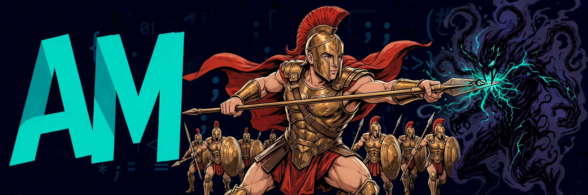

# Hola, soy Antonio Moles Leiva 👋

**Desarrollador web · Granada, España**

🌐 **Portfolio:** [elkangri23.github.io](https://elkangri23.github.io)

Me gusta construir aplicaciones que se usan de verdad: del backend a la interfaz, y últimamente con IA corriendo en local, donde yo controlo los datos.

> Aprendo construyendo. Si algo me interesa, lo programo, lo rompo y lo vuelvo a programar hasta que funciona.

---

## 🚀 Lo que estoy construyendo ahora

| Proyecto | Qué es | Stack |
|---|---|---|
| **[Meridiano-cero](https://github.com/elkangri23/Meridiano-cero)** | Juego público de investigación internacional. Motor determinista, generador de casos y partidas jugables en casa con tu propio LLM local. En español, inglés y francés. | TypeScript · Ollama / LM Studio |
| **[Retaton](https://retaton.laurafernandezenfermeria.com)** | App de interacción con la audiencia en español, estilo Mentimeter + Kahoot: presentaciones en vivo, preguntas, concursos con rachas y podio. | PHP · Laravel 13 · React · TypeScript · Inertia · MySQL · Redis |
| **[MapaMental](https://github.com/elkangri23/MapaMental)** | Clon funcional de MyMap.ai: mapas mentales generados por chat, con lienzo, diapositivas y presentación a pantalla completa. | TypeScript |
| **[listaCompra](https://github.com/elkangri23/listaCompra)** | Backend de lista de la compra colaborativa, para aprender Clean Architecture / Hexagonal con Outbox. | TypeScript |
| **[A mi ritmo](https://github.com/elkangri23/A-mi-ritmo)** | Teleprompter para Android con control desde Wear OS: guiones por secciones, lectura sin conexión y manos libres para ponencias y charlas. Prototipo funcional v0.1.0. | Kotlin · Android · Wear OS |

🌐 **En vivo:** [Meridiano-cero](https://meridianocero.laurafernandezenfermeria.com) · [Retaton](https://retaton.laurafernandezenfermeria.com)

---

## 🛠️ Stack

**Día a día:** PHP · Laravel · HTML · CSS · ASP.NET Web Forms · C# · SQL Server  
**Aprendiendo a fondo:** TypeScript · IA local (Ollama, LM Studio, ComfyUI, Docker)

---

## 📚 Formación

- **Técnico Superior en Desarrollo de Aplicaciones Informáticas** — 2007
- **Desarrollo de Aplicaciones Multiplataforma (DAM)** — 2015
- **Máster en Desarrollo con IA** — BigASchool, 2026

---

## 🌱 Ahora mismo

- 🔭 Terminando de pulir **Meridiano-cero** y **Retaton** en producción
- 🌱 Profundizando en **TypeScript** y en agentes de IA en local
- 💡 Explorando alternativas open source y autoalojadas a apps de pago

---

## 📊 GitHub

---

### 📫 ¿Hablamos?

- 💼 [LinkedIn — Antonio Moles Leiva](https://es.linkedin.com/in/antonio-moles-leiva-9700703a)
- Lo mejor para hablar de código es abrir un issue en alguno de mis repos públicos o encontrarme por aquí, en GitHub.
